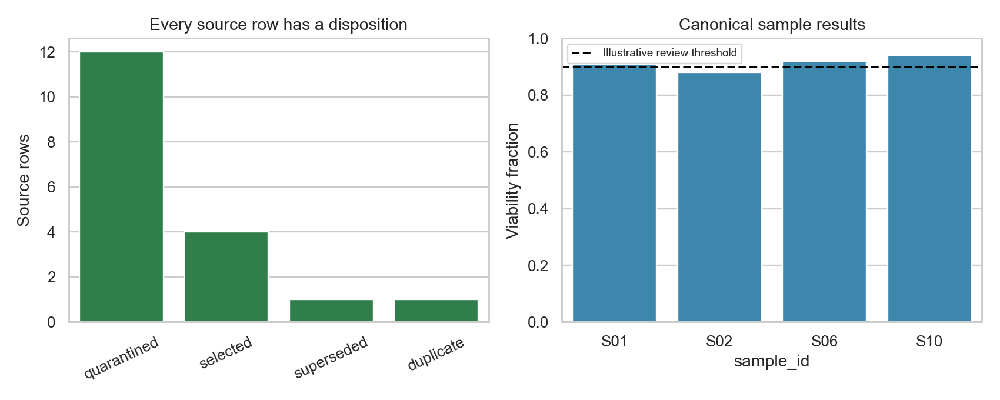

# Lab data reconciliation

Reconcile conflicting laboratory exports without silently reviving obsolete measurements.

**Question:** Which measurement is defensible when duplicates, revisions, units and metadata disagree?

**Data:** The 18-row laboratory export, sample metadata and independently hand-authored golden output are entirely synthetic.



## Analysis

1. Define one canonical result per sample and give every original row a stable audit position.
2. Deduplicate only identical payloads. Quarantine conflicting record identities and sample metadata.
3. Resolve the latest revision before filtering approval or measurement validity. Never fall back to an older approved result.
4. Require a unique approved latest revision, known units, finite viability within [0,1] and a timezone-aware timestamp.
5. Join metadata with one-to-one validation and reconcile every input row to exactly one disposition.

## Results

18 source rows resolve to 4 selected, 1 exact duplicate, 1 superseded and 12 quarantined rows. Canonical viability values are S01 = 0.91, S02 = 0.88, S06 = 0.92 and S10 = 0.94. Their mean is 0.9125. The naive approved-row mean is 0.92267 because its population and record weights differ.

## What the tests protect

Golden-output comparison, exact duplicate accounting, shuffle invariance, tied/conflicting identities, invalid and unapproved latest revisions, normalized numeric revision strings, boolean revision rejection, unit bounds, missing schemas and invalid timestamps. A differential suite compares the disposition and reason of every source row with an independent plain-Python formulation of the policy on 200 seeded messy exports (checked against deliberately broken versions of the reconciler), and checks row-order invariance, that reconciling the canonical output changes nothing, UTC storage of offset timestamps, record identifiers shared across samples, conflicting or duplicated metadata, and the command-line round trip.

## Libraries actually used

pandas for typed joins, grouping and audit tables; NumPy for numerical checks; Matplotlib and seaborn for disposition and sample-level plots.

## Interpretation limits

This is an explicit example policy, not a universal laboratory SOP or a validated regulated system. Real workflows require an authorized record hierarchy, audit-trail retention and controlled exception resolution. Quarantine preserves uncertainty; it does not establish that a sample failed. The illustrative 0.90 threshold is not a clinical or product-release specification. The mean comparison is not a treatment effect.

## Use it on your own export

```bash
python analysis.py reconcile EXPORT.csv METADATA.csv OUTPUT_DIR
```

The export needs the columns `record_id, sample_id, revision, status, value, unit, measured_at`; the metadata needs `sample_id, donor_id, condition`. The command writes `canonical.csv` (one row per sample), `row_audit.csv` (one disposition and reason per source row) and `dispositions.json` (counts). The policy is the explicit example policy described above, not a universal laboratory SOP.

## Run it

Python 3.13 is the tested runtime. Dependencies, including notebook execution, are pinned in `requirements.lock` (version pins, not a hash-locked supply-chain guarantee).

```bash
python3.13 -m venv .venv
source .venv/bin/activate
python -m pip install -r requirements.lock
python scripts/validate.py
```

The validation command runs pytest, regenerates results and executes every notebook cell. Outputs go to ignored `artifacts/run/`. The executed notebook is saved separately so the source notebook stays clean. `reports/reference/` retains checked outputs and the validation receipt from the delivered revision.

```bash
# Equivalent isolated run, without local Python setup
docker build -t lab-data-reconciliation:local .
docker run --rm --cpus=1 --memory=3g lab-data-reconciliation:local
```

The container runs as an unprivileged user. GitHub Actions uses the same Python validation entrypoint. Public-data downloads require network access; the other projects are offline after dependency installation.

## Navigate

- [Source notebook](notebooks/analysis.ipynb) and [executed notebook](notebooks/analysis.executed.ipynb)
- [Implementation](analysis.py)
- Tests: [hand-authored cases](tests/test_analysis.py) and [differential suite](tests/test_differential.py)
- [Actual findings and limitations](reports/reference/FINDINGS.md)
- [Machine-readable reference results](reports/reference/summary.json)
- [Analysis plan](docs/ANALYSIS_PLAN.json), a local design record rather than an externally registered protocol

## Authorship and use

Prepared for Kalif Shear's scientific Python portfolio with AI-assisted implementation. The code, tests and retained execution results are inspectable. These are new portfolio projects; synthetic and public-data provenance is disclosed above. Code is MIT licensed; any external source data remain subject to their own terms and attribution requirements.
